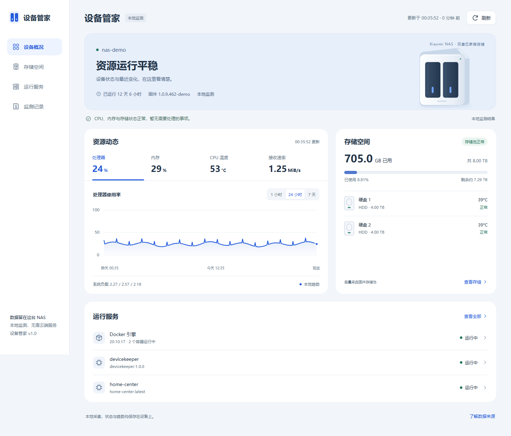
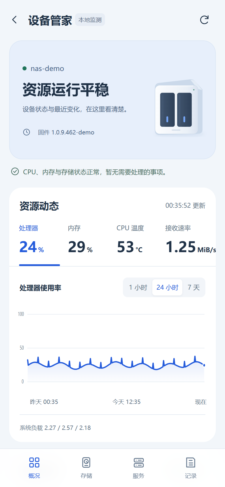
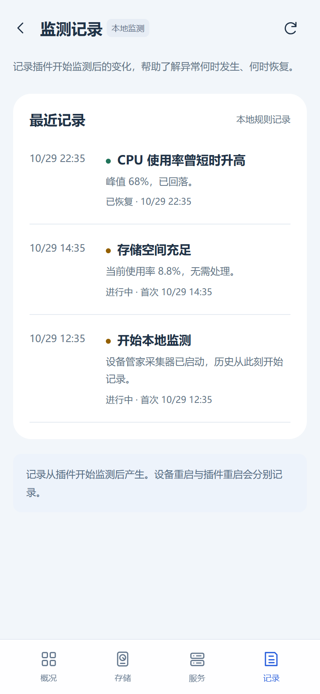

# 设备管家 Devicekeeper

小米 NAS 的只读设备监测插件。它把 CPU、内存、温度、风扇、网络、固件存储池、Docker 容器、systemd 白名单和本地监测记录集中到一个适配米家 WebView 的页面里。

[返回 NAS 插件主页](../../README.md)。

[](https://github.com/lzcy1326/xiaomi-nas-devicekeeper/actions/workflows/ci.yml)

> 非小米官方项目。插件依赖 NAS 固件的插件中心、Docker 和 `/proc`、`/sys`，不同固件版本可能需要调整。安装前请先阅读本文的安全边界。

## 效果

<p align="center">
  
</p>

<p align="center">
  
  
</p>

更多页面：[存储空间](docs/images/desktop-storage.png)。

截图使用演示主机名 `nas-demo` 和模拟数据，不包含真实 NAS 信息。

## 特性

- CPU、内存、负载、运行时间和网络收发速率
- CPU 温度、磁盘温度、固件风扇转速
- 固件 `NasStorage.getPoolInfo` 存储池与成员盘
- Docker 容器列表、运行状态、healthcheck 和资源统计
- 固定 systemd 服务白名单，不推送整机失败列表
- 1 小时、24 小时、7 天本地趋势
- 本地规则事件和游标分页
- 桌面与手机两套布局
- 只读：不重启设备、不启停容器、不改风扇、不清理磁盘

## 架构

```text
Mi Home WebView
      |
      | HTTPS 443 / plugin.cgi
      v
devicekeeper.cgi  ----  admin permission check (MIUID -> UCI)
      |
      | 127.0.0.1:9365
      v
Docker container: devicekeeper API + collector
      |
      +-- /host/proc, /host/sys       read-only
      +-- /host/nas/pool0            read-only
      +-- /state                     SQLite history and snapshot

systemd timer: devicekeeper-host-probe.service (root, every 15s)
      |
      +-- Docker Engine API via Unix socket, GET only
      +-- firmware Lua helpers via stdin, read-only
      +-- /state/host.json
```

页面和 API 只通过米家原生 `plugin.cgi` 登录链路开放。后端容器只绑定宿主的 `127.0.0.1:9365`，不直接对局域网或公网监听。

## 安装

### 前置条件

- 已开启开发者模式并可通过 SSH 登录的小米 NAS
- 可用的 NAS 插件中心 `plugincenter`
- Docker Engine 和 `/data/docker/docker`
- root shell
- 一个米家用户 UID，下文用 `<mi-uid>` 表示

### 部署

以下命令从仓库根目录开始执行，先进入插件目录：

```sh
cd plugins/devicekeeper
sudo mkdir -p /data/plugins/devicekeeper
sudo cp -a app deploy scripts tests ui INFO Dockerfile docker-compose.yml \
  /data/plugins/devicekeeper/
cd /data/plugins/devicekeeper
sudo DEVICEKEEPER_UID=<mi-uid> ./deploy/install-nas.sh
```

安装脚本会：

1. 安装并启动 15 秒宿主探针 timer。
2. 在 NAS 本地构建 `local/devicekeeper:1.0.0`。
3. 启动只读容器，并只发布到 `127.0.0.1:9365`。
4. 备份 `/data/plugin/u<mi-uid>.list` 后追加 `devicekeeper`。
5. 创建 Web 目录、源码目录和图标链接。

`DEVICEKEEPER_UID` 必须显式提供，仓库不再内置任何个人 UID。

### 验证

```sh
systemctl is-active devicekeeper-host-probe.timer
/data/docker/docker ps --filter name=devicekeeper
curl -fsS http://127.0.0.1:9365/api/v1/health
curl -fsS http://127.0.0.1:9365/api/v1/snapshot
plugincenter -u u<mi-uid> -p devicekeeper info
```

米家 App 内入口：

```text
https://<NAS>:443/plugin/<mi-uid>/devicekeeper/index.html
```

该地址必须由有效的米家登录态访问。不要把 `9365` 暴露到公网，也不要为插件添加绕过 `plugin.cgi` 的 Nginx alias。

## 配置

### 安装脚本环境变量

| 变量 | 默认值 | 说明 |
| --- | --- | --- |
| `DEVICEKEEPER_UID` | 无，必填 | 安装到哪个米家用户目录 |
| `DEVICEKEEPER_ROOT` | `/data/plugins/devicekeeper` | 插件源码目录 |
| `DEVICEKEEPER_IMAGE` | `local/devicekeeper:1.0.0` | 本地镜像名 |
| `DEVICEKEEPER_ALPINE_IMAGE` | `docker.1ms.run/library/alpine:3.20` | 构建基础镜像 |
| `DOCKER_BIN` | `/data/docker/docker` | Docker CLI 路径 |

### 容器环境变量

| 变量 | 默认值 | 说明 |
| --- | --- | --- |
| `HOST_ROOT` | `/host` | 宿主只读挂载根目录 |
| `STATE_DIR` | `/state` | SQLite、快照和事件目录 |
| `PORT` | `9365` | API 端口 |
| `BIND_ADDRESS` | `0.0.0.0` | 容器内监听地址，宿主侧仍只发布回环 |
| `COLLECT_INTERVAL_SECONDS` | `5` | 资源采集间隔 |

## API

所有接口默认同源访问，不把 token 写入 JS、URL 或 localStorage。

| 方法 | 路径 | 说明 |
| --- | --- | --- |
| `GET` | `/api/v1/health` | 采集器活性和快照新鲜度 |
| `GET` | `/api/v1/capabilities` | 当前固件支持的数据源 |
| `GET` | `/api/v1/snapshot` | 一次完整设备快照 |
| `GET` | `/api/v1/storage` | 存储池和成员盘 |
| `GET` | `/api/v1/services` | Docker 与 systemd 服务 |
| `GET` | `/api/v1/events?limit=50` | 本地事件，支持 `cursor` |
| `GET` | `/api/v1/history?metric=...&range=1h` | 本地趋势 |
| `POST` | `/api/v1/refresh` | 读取最新快照，不触发宿主写操作 |

`health` 返回 `503` 表示快照缺失或超过 30 秒未更新。

## 数据来源

| 数据 | 来源 |
| --- | --- |
| CPU、内存、负载、运行时间 | 宿主 `/proc` |
| CPU 温度、磁盘温度 | 宿主 `/sys` |
| 网络速率 | 默认路由所在活动物理网卡 |
| 存储池与成员盘 | 固件 `NasStorage.getPoolInfo` |
| 存储回退 | `statvfs`，与固件口径分开标记 |
| 风扇 | 固件 `mifan rpm` |
| Docker | 宿主 root 探针读取 Unix Socket，只发 GET |
| systemd | 固定白名单 |
| 历史与事件 | 容器内 SQLite |

## 安全边界

- 容器以 `10001:10001` 运行，rootfs 只读，`cap-drop ALL`，`no-new-privileges`。
- 容器不挂载 Docker Socket。Docker 读取由宿主 root 探针完成。
- `/proc`、`/sys`、`/nas/pool0` 以只读方式挂载。
- 容器使用 `pids-limit 64`、`memory 192m`、`cpus 1.0`。
- 宿主探针只执行固定的只读查询，不接收用户输入。
- 页面和 API 在 CGI 层按登录用户 `MIUID` 查询 UCI `permission`，非 `admin` 直链返回 `403`。
- 服务只绑定 `127.0.0.1:9365`，不直接暴露公网。
- 不记录 token、密码、完整设备序列号或容器环境变量。

## 开发与测试

后端只依赖 Python 标准库。测试：

```sh
python -m unittest discover -s tests -v
```

前端静态文件在 `ui/`，由容器 API 直接托管；生产入口仍由米家 `plugin.cgi` 代理。

## 兼容性

已在四核 aarch64 小米 NAS、固件 `1.0.9.462` 系列上完成 72 项安装后验收：

- 插件中心识别和 `.list` 注册
- admin 可见、普通用户不可见且直链 403
- 首页、CSS、JS、图标和 API 全部 200
- 容器 healthy、宿主探针成功、SQLite 完整
- CPU、内存、温度、风扇、网络、存储、Docker、systemd 数据可用
- 现有插件保持完整

详见 [验收记录](docs/verification.md)。

已知限制：

- 低负载时固件 `mifan rpm` 可能返回 `0`，这是有效读数，不是采集失败。
- 刚安装时历史覆盖率会从低值逐步增长。
- 不同固件版本的 Lua 路径、字段和 Docker 版本可能不同。
- 米家 App WebView 的登录、返回和安全区行为需要在目标手机上确认。

## 目录

```text
app/                    API、采集器、宿主数据解析
deploy/                 宿主探针、systemd unit、安装和注册脚本
scripts/control          plugincenter 生命周期入口
tests/                  标准库 unittest
ui/                     WebUI、样式、图标和 devicekeeper.cgi
docs/                   插件架构、验收记录和效果图
assets/                 图标源文件
```

## 许可证

[MIT](../../LICENSE)
