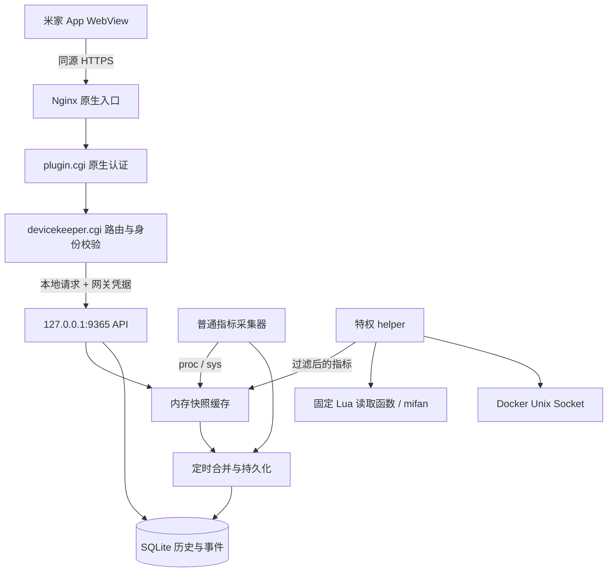

# 小米 NAS 设备管家：技术架构与界面设计

版本：1.0 · 日期：2026-10-30 · 插件标识：`devicekeeper`

## 1. 结论与交付范围

采用“米家原生鉴权入口 + 插件 CGI 网关 + 本地只读采集 + SQLite 趋势存储”的本地服务型插件架构。前端围绕设备概况、资源、存储、服务组织信息；优先回答“现在发生了什么、哪里需要关注、数据是否可信”。

数据来源已在项目对应 NAS 上核查：CPU、内存、负载、运行时间、温度可从 Linux 节点获取；固件已有设备状态和存储 API；Docker Engine 的本地 HTTP API 已返回真实容器。详情见 [验收记录](verification.md)。原生接口不是公开稳定 SDK，不能把当前固件行为推广到所有版本。

本次交付为已实现并通过安装后验收的插件。页面、接口和部署结果见插件 [README](../README.md) 与 [验收记录](verification.md)，效果图见 [images](images/desktop-overview.png)。

## 2. 产品边界

主要用户是 NAS 管理员，主要场景是米家 App 的 WebView。首版提供设备状态、资源趋势、存储池和成员盘、选定系统服务与容器状态、规则产生的本地事件。

首版不提供重启设备、启停容器、磁盘格式化、修改风扇模式、执行命令或清理文件。后续增加写操作时，需要独立的动作权限、CSRF 防护、结果核对和审计方案，不能复用只读接口直接扩展。

设备健康以监测到的事实表达：如“资源平稳”“存储池异常”“部分数据未更新”。不生成没有依据的 98 分健康分；CPU 负载不能推断硬盘健康；Docker active 不能证明业务可用；未采集不能当作正常。

## 3. 参考页面的问题与重新设计

### 3.1 设计判断

参考图的共同问题：标题和介绍占用首屏；指标分散在等大的大卡片里；CPU、内存和磁盘的视觉权重相同；展开趋势会把后续指标推到很远；24 小时标题和实际时间范围可能不一致；图表没有说明断点和采样范围；服务名被写成固定产品。

新方案以 NAS 机身的“双盘位”作为唯一明显的品牌视觉，其余区域保持轻量。用一个资源工作区切换 CPU、内存、温度和网络，用紧凑存储结构解释“池”与“盘”，保留清晰的服务状态表。取消重复大标题和装饰性说明文案。

### 3.2 设计令牌

| 令牌 | 值 | 用途 |
| --- | --- | --- |
| 画布 | `#F2F6FA` | 冷灰蓝背景，呼应家用存储设备外壳 |
| 表面 | `#FFFFFF` | 图表、列表、主要内容 |
| 正文 | `#203247` | 主信息和标题 |
| 次级正文 | `#607286` | 单位、时间、辅助说明 |
| 品牌蓝 | `#245BDB` | 选中态、曲线、操作入口 |
| 状态绿 | `#21745B` | 经过验证的正常状态；警告 `#946000`、异常 `#B33243` 为语义扩展 |

字体优先使用系统可用的 MiSans / HarmonyOS Sans SC / Microsoft YaHei，英文和数值沿用同族并开启 tabular-nums；不为页面加载外部字体。标题 24–28px，区域标题 17–20px，关键数值 30–34px，正文 14–16px，辅助文案至少 12px。避免用等宽小字营造无实际意义的“技术感”。

布局统一左对齐；数值列右对齐。间距以 4px 为基数，内容间距 16/24px，桌面工作区最大 1200px。分组面板圆角 18–22px，按钮 10–12px，状态标签为胶囊；主要依靠留白和分隔线，不给每行加阴影。NAS 机身插画与双盘结构对应真实两盘位设备，不暗示已检测到某种 RAID 模式。

### 3.3 信息架构

```text
设备管家
├─ 概况：设备身份 / 当前关注项 / 资源曲线 / 存储概览 / 服务摘要
├─ 存储：池容量 / 池状态 / 两个成员盘 / 温度与已报告健康
├─ 服务：Docker 引擎 / 容器列表 / 选定系统服务
└─ 记录：本地规则事件 / 来源 / 首次与最近发生 / 恢复时间
```

桌面布局：

```text
┌────────┬────────────────────────────────────────────────┐
│ 设备管家│ 设备管家                   更新于 …    刷新    │
│ 概况   ├────────────────────────────────────────────────┤
│ 存储   │ NAS 双盘位插画   主机名 / 版本 / 运行时间       │
│ 服务   │ 当前关注项（含数据完整性）                       │
│ 记录   ├─────────────────────────────┬──────────────────┤
│        │ CPU / 内存 / 温度 / 网络     │ 存储池           │
│        │ 共用曲线 + 1h / 24h / 7d    │ 容量 + 成员盘    │
│        ├─────────────────────────────┴──────────────────┤
│        │ 服务状态                               查看全部│
└────────┴────────────────────────────────────────────────┘
```

移动布局：

```text
┌──────────────────────────┐
│ 返回   设备管家     刷新  │ ← 宿主已有导航时合并，避免双导航
│ 主机名 + 小型双盘位插画   │
│ 当前关注项 / 最近采集时间 │
│ CPU  内存  温度  网络     │ ← 四列紧凑切换
│ 当前指标、曲线、时间范围  │
│ 存储池容量 + 成员盘      │
│ 服务摘要                 │
│ 概况   存储   服务   记录 │ ← 内容预留底部安全区
└──────────────────────────┘
```

第一轮自评曾考虑“四张彩色仪表卡”，但它与参考图同样割裂信息，因此改为共用资源工作区。机身插画只出现在设备身份区；列表使用简单符号和文字，不为 CPU、内存、存储各画一个彩色应用图标。

### 3.4 关键交互与状态

| 场景 | 行为与文案 |
| --- | --- |
| 首次进入 | 分区骨架；CPU 两次采样前显示“正在采集”，不显示 0% |
| 切换指标 | 曲线、单位、当前值、统计范围一起切换；选中态有形状和文字反馈 |
| 切换时间 | 标题使用实际请求范围；历史不足显示“已记录 23 分钟”，保留空白，不补假点 |
| 查看峰值 | 触摸或键盘定位采样桶，展示时间、均值、最小值、最大值；页面在 1h/24h/7d 间切换均值 |
| 下拉 / 点击刷新 | 立即读最新快照，必要时触发合并刷新；不为每个用户创建一套采集循环 |
| 未更新 | 保留最后值并标注时间；超过阈值显示“数据已过期”，断线曲线不连接 |
| 无读取能力 | 显示“此固件未提供读数”或“无读取权限”；0 是有效数字，不能代表缺失 |
| 风扇 0 rpm | 显示“当前 0 rpm”；只有结合温度、模式、持续时间和固件语义验证后才能报警 |
| 服务详情 | 展示来源、状态、最后更新时间；不在首版放置启停按钮 |
| 历史为空 | “开始监测后会记录趋势”；设备重启与插件重启在时间线上区分 |
| 身份失效 | 停止请求，提示“登录状态已失效，请返回米家后重新打开”；不要求用户手输 token |

前台默认每 5 秒请求快照；页面隐藏时停止轮询，恢复时立即同步；失败按 5、10、20、30 秒退避，不允许多个请求重叠。手动刷新不清空可用数据。读屏通过礼貌通知报告手动刷新结果，不每 5 秒播报全部读数。

移动端最低 360px，桌面从 960px 使用侧栏和双栏；360–959px 为单栏和底部导航。触摸目标至少 44px；focus 可见；尊重 reduced-motion；状态同时使用文本和颜色；显示安全区与宿主导航的最终组合必须在真实 WebView 验证。

### 3.5 插件图标

图标采用“**双盘位 NAS + 状态波形**”：白色设备机身和两条深色盘位延续页面设备插画，右下角圆形波形标记表示设备监测。蓝色底承接页面主色，让图标在应用列表中与存储设备的轮廓一同识别；不放文字、百分比或细小刻度。


底色使用 `#3C7DF4 → #2455CD` 的轻微明度变化；机身 `#FFFFFF → #DDE9FC`；盘位 `#344E73 → #203651`；波形 `#245BDB`。512px 母版中背景圆角 112px，主体在约 70–442px 的安全范围内。双盘位和波形保留较粗轮廓，已查看 48px 缩略图，仍可区分设备与监测标记。

| 资源 | 用途与格式 |
| --- | --- |
| [icon.svg](../assets/icon.svg) | 可编辑矢量母版，512×512 viewBox，无字体或外链依赖 |
| [icon.png](../assets/icon.png) | 300×300 RGBA PNG，运行时图标源文件 |
| [icon-512.png](../assets/icon-512.png) | 512×512 RGBA PNG，应用商店素材预备文件 |
| [icon-48.png](../assets/icon-48.png) | 48×48 缩略图，用于检查应用列表中的辨识度 |

所有文件位于插件的 `assets/`。部署时安装脚本把 `ui/icon.png` 复制为 `/data/plugin/www/icon/devicekeeper.icon`；`.icon` 只是 PNG 文件的部署扩展名，不是 Windows ICO。图标中的波形是固定品牌图形，不代表设备实时正常或异常；运行状态仍由页面文字和状态组件表达。

## 4. 技术选型与组件边界

| 层 | 方案 | 理由 |
| --- | --- | --- |
| 前端 | TypeScript + 原生 Web Components + 本地 SVG 图表 | 页面规模有限，无运行时 CDN；编译后静态资源适合 WebView |
| UI 网关 | Python CGI 小入口，路由及静态资源白名单 | 延续 `plugin.cgi` 认证链，准确转发状态码与 JSON |
| API 服务 | Python 3.12 本地 HTTP 服务 | 实机已有运行时；缓存快照、历史查询与权限过滤 |
| 特权采集 | 独立受限 helper + Unix Socket | 主 API 不持有 Docker Socket，也不接受执行命令参数 |
| 历史 | Python sqlite3，单写入器 | 实机可用，部署无需数据库服务 |
| 守护 | systemd 前台进程 | 重启恢复、资源限制、日志和生命周期统一 |

Python HTTP 服务使用有上限的请求并发与超时、请求体限制和显式路由；不直接把无界线程版开发服务器作为正式部署方案。CGI 请求与采集解耦，API 超时不得拖住定时采集。最终构建工具、包版本与 WebView 兼容目标在实施时锁定。



端口 9365 是建议值，本次检查未发现该端口监听；安装时仍须重新检查冲突。INFO 的 `port` 保持字符串 `"9365"`。单设备共享一套采集后端，每个用户的插件入口仅作为授权网关，避免每个 UID 启动一套采集器。

## 5. 数据源与适配策略

| 页面字段 | 首选来源 | 回退与限制 | 实测状态 |
| --- | --- | --- | --- |
| CPU 总使用率、核数 | `/proc/stat` 差分、online CPU | 原生 `cpu.use` 仅作显式标注的回退，不与差分曲线混接 | 已读取 / 计算 |
| 内存已用 / 总量 | `/proc/meminfo` | 缺少 MemAvailable 时标 unavailable，首版不猜缓存回收量 | 已读取 |
| 1/5/15m 负载 | `/proc/loadavg` | 独立于 CPU % | 已读取 |
| 设备运行时间 | `/proc/uptime` + boot_id | API 自身 uptime 单独记录 | 已读取 uptime；boot_id 待实现 |
| CPU 温度 | thermal type=`cpu-thermal` | 固件 `cpu.temp` 字符串解析；记录来源切换 | 已读取 |
| 风扇模式 / RPM | 固件受限 Lua / `mifan rpm` | hwmon 可发现则采用；不可读为 null | 函数和 CLI 成功 |
| 存储池容量 / 状态 | `NasStorage.getPoolInfo` 的 internal_pool | statvfs 作为单独 fs 口径回退，不混用 | 默认分支成功，selector 待联调 |
| 磁盘温度 / 已报告健康 | 固件池成员数据；已映射 drivetemp | 无健康字段时 unknown，不从温度推健康 | 已读取 |
| 网速 | 默认路由物理接口 rx/tx bytes 差分 | 丢弃 loopback、bridge、虚拟隧道，接口变化重置 | 活动接口计数已读取 |
| 网络链路速率 | sysfs speed | 不支持时显示未提供，不按网卡型号猜测 | 本机不可读 |
| 系统服务 | systemctl show 固定白名单 | 同时解释 ActiveState / SubState，非全量故障扫描 | 已读取 |
| Docker / 容器 | Unix Socket 的 ping/version/containers | 未安装、无权限、不可达分别处理 | 三项 HTTP 200 |
| 趋势 / 记录 | 插件自行持久化 | 尚未发现可复用原生历史接口；安装前历史不回填 | 需开发 |

适配器按“字段”失败隔离。高频任务不直接调用整套 `get_device_status`，避免其串联的工厂信息、网络和存储查询。固件适配器的输入固定，禁止把 HTTP 参数透传到 Lua 函数名或命令。

### 5.1 计算口径

- CPU：取 `/proc/stat` 前 8 个字段 user、nice、system、idle、iowait、irq、softirq、steal 的差分；`busy% = 100 × (Δtotal - Δidle - Δiowait) / Δtotal`。guest/guest_nice 已含在 user/nice，不能再次相加。iowait 单独可选展示；其回退或计数异常时该窗口作废。此口径在产品帮助中说明。
- 内存：`used_bytes = (MemTotal - MemAvailable) × 1024`；缓存可回收部分不会全算成已用。百分比以同次采样 total 为分母。
- 温度：sysfs 毫摄氏度除 1000；固件 `"53℃"` 转为 53。保留精度，UI 通常 1 位小数；传感器类型和关联依据随结果保留。
- 网络：bytes 差分除以单调时钟间隔；展示接收、发送速率，单位 KiB/s / MiB/s；不与 Mbps 链路速率混淆。计数回退、接口替换、设备重启时产生空点。
- 存储：统一内部 bytes。默认 UI 使用 TB / GB（十进制），详情可切 TiB / GiB（2 的幂）；页面也使用十进制。固件池本次约 8.00 TB、已用约 705.9 GB、8.82%。statvfs 使用 total、used、available 各自同源，保留保留空间差异。
- 时间：API 为 UTC RFC3339；间隔由单调时钟计算，UI 按用户本地时区显示。客户端时间与 NAS 时间偏差过大时提示。NTP 回拨、boot_id 改变时不跨段连线。

口径参考：[Linux /proc](https://docs.kernel.org/filesystems/proc.html)、[hwmon sysfs](https://docs.kernel.org/hwmon/sysfs-interface.html)、[Docker API 1.41](https://docs.docker.com/reference/api/engine/version/v1.41/)。这是指标定义依据；NAS 特有字段以实机核查为准。

### 5.2 采集计划与节能

| 任务 | 周期 | 超时 / 缓存 |
| --- | --- | --- |
| CPU、内存、负载、网络 | 5 秒 | 小文件读取；快照直接返回，不请求内 sleep |
| CPU 温度、风扇 | 10 秒 | helper 子任务最多 2 秒，失败独立记录 |
| Docker、选定系统服务 | 15 秒 | Socket / 子进程各 2 秒；单次不并发枚举所有细节 |
| 池容量 / 状态 | 60 秒候选 | 5 秒上限；必须先通过休眠影响测试 |
| 磁盘 SMART / 温度 | 首版无额外高频主动 SMART 查询 | 复用固件缓存；可能唤醒磁盘则只在详情页手动请求 |
| 设备名、固件、适配能力 | 启动及 10 分钟 | 缓存，不为每个快照重新读工厂信息 |

字段 freshness 根据周期独立计算：通常超过 3 个周期 + 5 秒为 stale。无法保证不唤醒磁盘时，停止相关后台查询，保留最后值和时间；不能为了一条连续温度曲线让磁盘持续工作。

## 6. 本插件 API 契约（拟新增）

以下是本项目设计的接口，**不是已存在的小米官方接口**。相对基址从当前页面 URL 解析到 `/plugin/<uid>/devicekeeper/`；不硬编码主机地址、用户 UID 或公网 8443。前端同源携带现有会话，不把 token 放进 JS、URL 或 localStorage。

| 方法与相对路径 | 职责 |
| --- | --- |
| GET `api/v1/capabilities` | 固件、适配版本、支持字段、来源及降级原因；仅返回当前用户允许的能力 |
| GET `api/v1/snapshot` | 最新缓存快照，各字段质量、采集时间，设备身份和当前关注项 |
| GET `api/v1/history?metric=cpu.busy_pct&range=24h` | 有界历史桶；metric/range 必须在枚举内 |
| GET `api/v1/storage` | 池、盘、口径、采集时间；过滤序列号等非必要信息 |
| GET `api/v1/services` | 固定系统服务和经过授权的容器摘要 |
| GET `api/v1/events?cursor=...&limit=50` | 稳定游标分页，limit 上限 100；不接受任意日志路径 |
| POST `api/v1/refresh` | 合并触发异步读取；需同源检查和会话绑定 CSRF 校验，5 秒去重 |

快照结构示例（值为说明示例，不是一次完整实测响应）：

```json
{
  "schema_version": 1,
  "request_id": "opaque-id",
  "generated_at": "2026-10-29T14:42:00Z",
  "device": {"hostname": "nas-demo", "firmware": "1.0.9.462.F24C26D24-REL"},
  "collection": {"state": "partial", "last_success_at": "2026-10-29T14:42:00Z"},
  "metrics": {
    "cpu.busy_pct": {
      "value": 9.45, "unit": "percent", "quality": "ok",
      "source": "linux.proc_stat", "sampled_at": "2026-10-29T14:42:00Z",
      "interval_ms": 5000
    },
    "fan.rpm": {
      "value": 0, "unit": "rpm", "quality": "ok",
      "source": "firmware.mifan", "sampled_at": "2026-10-29T14:42:00Z"
    },
    "network.link_mbps": {
      "value": null, "unit": "megabits_per_second", "quality": "unsupported",
      "source": "linux.sysfs", "sampled_at": null,
      "reason": "driver_does_not_expose_speed"
    }
  }
}
```

quality 枚举：`ok`、`warming_up`、`stale`、`unsupported`、`permission_denied`、`error`。质量和时间逐指标存储；聚合状态不能掩盖部分失败。`null` 为未知，不能转成零。数值必须有限，JSON 不允许 NaN/Infinity。

历史响应包括 `requested_from/to`、`available_from/to`、`resolution_seconds`、`coverage`、`segments`、`buckets[{start,end,count,avg,min,max}]`。无有效样本的桶返回 null；时间跨度超过 2 个采样窗口或 boot_id / 来源改变时断线。零历史返回 200 和空数组，不能用 404 表示未开始记录。

状态码：400 参数非法，401 身份缺失/过期，403 无设备管理权限，404 路由不存在，429 读取过频，503 必需采集服务不可用。可恢复的单指标错误通过 200 的质量字段表达。CGI 必须保留 HTTP 状态，不能把登录 HTML、上游 403 或超时伪装成成功 JSON。

## 7. 趋势存储与事件模型

按固定表记录 numeric metrics、服务快照和规则事件；不存原始 token、完整设备序列号、容器环境变量、挂载路径和无限增长的服务日志。

```text
metric_raw(boot_id, series_id, ts_utc_ms, mono_ms, value, quality, source)
metric_rollup(series_id, bucket_start, step_s, sum, count, min, max)
events(id, rule_id, subject_id, state, opened_at, last_seen_at, resolved_at, evidence_json)
metadata(key, value)
```

`series_id` 含接口 / 传感器 / 池的稳定标识；hwmon 编号和临时网卡索引不能直接作为永久身份。以 `(series_id, boot_id, mono_ms)` 去重；按 `(series_id, ts_utc_ms)` 索引。原始表保留质量和来源变更，以便解释历史断点。

保留策略：5 秒原始点保留 24 小时；1 分钟聚合保留 7 天；15 分钟聚合保留 30 天；事件保留 90 天或 2000 条。1h 默认 5 秒、24h 默认 1 分钟、7d 默认 15 分钟，返回点数上限 1440。合并不同分辨率时以 sum/count 加权，不能对均值再次简单平均。

按 12 条高频序列估算，每日约 207,360 个原始点；含索引、WAL、聚合及日志需要实测，初始总预算 128 MiB。60 秒批量提交；单写入器；WAL 与 checkpoint 周期受控；到达配额先清理最旧历史，不能影响快照。磁盘满时切换内存环形缓冲并展示“历史暂停记录”，不得把数据库失败解释为设备离线。

数据库放在安装阶段确认的本地持久路径 `<state_dir>`，权限 0700/0600；禁止放在 `/tmp` 或 NFS/SMB。优先评估 `/data` 的空间与固件保留行为，并在目标文件系统验证 SQLite 锁与掉电恢复。若迁往 NAS 池，必须重新评估唤醒磁盘、FUSE 锁及性能，不直接启用 WAL。升级前备份，小事务迁移；异常恢复失败时保留原库并新建，不静默覆盖。

事件是插件根据采样产生的本地记录，首版没有系统推送。建议规则（可配置草案，不是厂商硬件故障阈值）：CPU ≥90% 持续 2 分钟、内存 ≥90% 持续 5 分钟、池使用率 ≥85% 持续 10 分钟、已选关键服务连续 3 次失败、固件明确报告池异常。恢复采用回差，例如 CPU <80% 持续 2 分钟。温度阈值优先取传感器 / 厂商定义，未确认前仅展示读数。状态迁移和同规则同对象去重；stale 数据不推进持续时长，也不自动恢复事件。

## 8. 鉴权、权限与部署

### 8.1 鉴权链

保留原生 `/plugin` → `plugin.cgi`，首版不添加绕过认证的 Nginx alias 或全路径反代，也不复制规范中的 `Access-Control-Allow-Origin: *`。UI 和 API 都经同一登录入口。

在 LuCI 的 NasAuth 源码中可见认证后设置 MIUID、USER、UID、GID 等环境变量；**尚未确认二进制 plugin.cgi 向子 CGI 传递相同变量**。实施第一个验证项就是取得可信主体并完成双用户越权测试。网关默认拒绝缺少已验证主体的请求，不能只凭 URL UID、请求头 UID 或文件目录所有者放行。仅在管理员明确授权的安装 UID 下注册，且每次请求仍需校验主体和角色。

API 仅监听回环地址，CGI → API 使用运行时随机凭据和已认证主体信息；API 只信受控网关注入，忽略客户端同名头。凭据放在 root 可读运行时文件，不能进入前端、日志或备份公开目录。若非 root CGI 无法安全读取凭据，则改用带权限的 Unix Socket，不通过放宽文件权限解决。

普通 API / 历史服务使用专用低权限账户。helper 是独立特权进程，仅接受固定读取枚举，固定 subprocess argv、受控 PATH、超时和输出大小；不提供通用命令或任意 URL / 文件路径接口。Docker Socket 仅由 helper 接触。helper 输出先去除容器命令、标签、挂载和环境变量等无关字段，不能把原始 Docker JSON 直接返回浏览器。

### 8.2 文件布局

```text
devicekeeper/
├─ INFO
├─ files/
│  ├─ api.py / collector.py / helper.py
│  ├─ adapters/（linux、固件版本、docker、systemd）
│  └─ server.sh（仅委托 systemd）
├─ scripts/control
├─ deploy/（预检、注册补丁、unit、备份回滚）
└─ ui/
   ├─ index.html
   ├─ devicekeeper.cgi
   ├─ icon.png
   └─ static/（内容哈希的 JS / CSS / SVG）
```

安装时发现 UID 与目录，不能套用 `/data/plugin/www/<uid>`：本机实际为 `u<uid>`。HTTP 路径与文件路径分别配置并独立验收。INFO、插件目录名、`.list` key 均为 devicekeeper，name 为设备管家；分配未占用数字 ID，不照抄规范中的 99。

两份 INFO 的实际位置按当前固件既有插件确认并同步；`.list` 只原子更新本插件 key，保留其他插件，保证 info 完整、resource.mpk 指向真实 INFO、frontend.url.url 为 `/index.html`。图标运行时为 300×300 PNG，复制为 devicekeeper.icon；商店素材不是本次手动部署内容。

CGI 限制静态根目录与扩展名，realpath 后检查根目录边界，拒绝路径穿越、编码穿越、符号链接逃逸、直接请求 CGI 源文件和未知 API。HTTP 请求路径只映射白名单，不作为本地 URL 拼接目标。动态 HTML 和 API no-store；内容哈希静态资源可缓存；前端设置合理 CSP，所有资源本地供应。

systemd 直接运行前台主进程；server.sh 与 control 委托同一组 unit，不能另起 nohup。主服务可设置 NoNewPrivileges / ProtectSystem 等，helper 的硬化选项必须与实际所需权限验证后配置。enable、disable、postinstall 等动作集合按固件现场确认；disable 停止采集而保留配置与历史；卸载明确区分删除程序与删除用户历史。

### 8.3 发布与回滚

1. 预检固件、端口、Python、sqlite、UID、目录、认证上下文和辅助命令；输出差异报告。
2. 备份 `.list`、两份 INFO、相关 unit；只有确需改变 Nginx 时才备份并修改其配置。
3. 发布版本目录、检查语法与权限，校验完整 manifest；先启动后端并验证本机健康。
4. 原子合并注册项、创建 UI 链接、复制图标，通过真实 App 入口验证静态资源和 API。
5. 重启 NAS 验证自启动和注册持久性；固件升级后重新跑适配与权限检查。
6. 失败恢复注册备份并切换旧版本目录；数据库迁移失败保留原库，不回滚为无法读取的新 schema。

该链路首版预计不需要修改 Nginx 配置，减少固件升级后的维护面。现有公网 8443 是另一条 Caddy 入口，本插件不自动追加公网发布规则。

## 9. 实施顺序、性能与验收

| 阶段 | 交付与退出条件 |
| --- | --- |
| D0 认证及固件适配验证 | App 可读取身份；两用户隔离通过；selector 与休眠影响已测；字段及来源固定 |
| D1 核心采集与 API | CPU 差分 / 内存 / 温度 / 服务成功；缺权限与超时不会拖垮整页 |
| D2 页面落地 | 按设计实现；移动 / 桌面、真实 WebView 返回与安全区通过；数据质量状态完整 |
| D3 历史与事件 | 断线断点、跨重启、聚合峰值、时钟回拨、配额与数据库恢复通过 |
| D4 部署验收 | 注册不影响其他应用；重启恢复；disable / 升级 / 回滚演练完成 |

性能目标均需实测：首屏 <3 秒，缓存 snapshot p95 <200ms，历史查询 p95 <500ms；采集与 API 主服务平均 CPU <1%（以全机四核容量计），RSS 目标 <60 MiB，helper 单独计入；前端 gzip 后资源目标 <180 KiB。任何目标达不到都要记录瓶颈，不能通过降低显示真实性达标。

必要验收场景：

- 固定 CPU 计数夹具覆盖 guest 重复统计、计数回退、CPU 热插拔和首次采样；内存覆盖缓存充足及 MemAvailable 缺失。
- 存储使用原生池数据，与 App / 原生函数同一时刻对照；池和磁盘容量不可重复累加；disk sleep 下验证无意外唤醒。
- Docker 不存在、权限拒绝、超时、容器无 healthcheck、容器退出分别显示；`active/exited` 与 failed 正确区分。
- 未登录、过期登录、普通用户、跨 UID、伪造身份头、路径穿越均被拒绝；不输出原始 token、SN 或 Docker 敏感字段。
- 网络抖动、App 后台 / 恢复、手动刷新并发、历史为空、数据过期、部分失败都有可读反馈。
- 时间范围真实、聚合保留峰值、断点不插值；数据库满 / 损坏、设备重启、采集器重启不会伪造连续历史。
- 360 / 390 / 768 / 1440px 检查横向溢出；键盘、读屏、文字放大、reduced-motion 和底部安全区检查。

## 10. 已定决策与未决项

已定：本地只读首版；原生认证链；分指标采集和质量模型；原生存储口径优先；动态发现服务；独立历史；不固定展示 OpenClaw；不把风扇 0 rpm 判错；不混合固件池与 df 容量。

进入实施前必须关闭的未决项：plugin.cgi 的可信身份上下文与管理员判定；真实 App HTTP 调用；插件生命周期的准确动作；持久目录及 SQLite 文件系统兼容性；休眠期间存储与温度采集副作用；目标 WebView 特性和宿主导航集成。它们不影响本次设计交付，但会影响运行插件能否安全、准确地发布。

参考资料：[开发规范](../../../docs/nas/plugin-development-spec.md)、[验收记录](verification.md)、[桌面效果图](images/desktop-overview.png)。开发规范是第三方实测整理；本文以当前实机证据修正其路径和认证假设，最终以实施验收结果为准。
